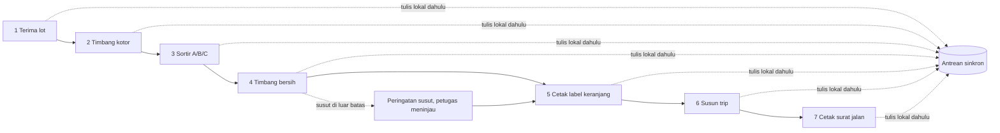

# Flow Gudang: Terima Lot sampai Surat Jalan (desktop Windows)

Tiket LMB-DSG-003. Sumber: FSD/10-alur (urutan layar, tulis lokal dahulu), PRD/20-alur langkah 3 (timbang ganda dan sortir pagi), BRD/30 (fee). Flow ini tidak mengubah requirement; ia memetakan layar ke alur. Layar: [`screens/gudang-desktop.md`](../screens/gudang-desktop.md); struk: [`screens/struk-fee.md`](../screens/struk-fee.md).

Batas waktu terdokumentasi: dari bongkar sampai susun muat selesai maksimal 30 menit (PRD/20 langkah 3). Desain mengejarnya dengan satu aksi utama per layar, target sentuh/klik `size.target-sarung`, dan lanjut otomatis ke layar berikutnya setelah simpan.

## Diagram

## Langkah

| # | Langkah | Layar | Pelaku | Masukan | Keluaran | Aksi utama |
|---|---|---|---|---|---|---|
| 1 | Terima lot | Dasbor Hari Ini, lanjut Timbang Lot | Admin gudang | Pilih trip masuk; pindai/ketik id lot; cek komoditas dan asal kebun | Lot berstatus "diterima" | Terima Lot |
| 2 | Timbang kotor | Timbang Lot | Admin gudang | Angka timbangan (USB/serial) | Berat kotor (gram bulat) tersimpan lokal | Simpan Berat Kotor |
| 3 | Sortir A/B/C | Hasil Sortir | Admin gudang | Berat per grade A, B, C | Pembagian grade tersimpan lokal | Simpan Hasil Sortir |
| 4 | Timbang bersih | Timbang Lot (mode bersih) | Admin gudang | Angka timbangan setelah sortir | Berat bersih; selisih/susut tampil sebagai informasi | Simpan Berat Bersih |
| 5 | Cetak label | Cetak Label | Admin gudang | Pilih keranjang/grade | Label keranjang tercetak, status cetak tersimpan | Cetak Label |
| 6 | Susun trip | Susun Trip | Admin gudang | Pilih lot teralokasi ke trip, urutan titik antar | Trip tersusun dan siap muat | Simpan Trip |
| 7 | Cetak surat jalan | Cetak Surat Jalan | Admin gudang | Pilih trip | Surat jalan tercetak (nomor sementara `TMP-` bila offline) | Cetak Surat Jalan |

Dukungan: Arsip Kontrak (baca saja) dibuka dari bilah samping di semua langkah untuk merujuk kontrak petani; bukan langkah wajib. Struk fee dicetak dari Timbang Lot setelah langkah 4 (lihat struk).

## Aturan yang terlihat di desain

- Tulis lokal dahulu: setiap simpan langsung menampilkan sukses tanpa menunggu server (FSD/10 butir 1). Desain tidak menampilkan spinner jaringan pada aksi simpan.
- Bilah atas semua layar: status Online atau Offline dan jumlah antrean (FSD/10). Offline memakai `color.oranye-offline`, Online `color.hijau-daun`; selalu disertai teks, bukan warna saja.
- Nomor sementara `TMP-` (8 karakter) pada lot dan surat jalan saat offline, diganti nomor resmi saat sinkron (FSD/10 butir 3).
- Konflik: gudang menang untuk berat dan grade; layar menampilkan pemberitahuan bila nilai lapangan dikalahkan (FSD/10 butir 4).
- Offline lebih dari 3 x 24 jam: tombol "Cetak Surat Jalan" terkunci dengan alasan tertulis; timbang dan bukti tetap bisa (FSD/10 butir 5).
- Uang integer rupiah, berat integer gram; desain hanya menampilkan angka dari sistem dan tidak menghitung ulang fee atau grade (AGENTS repo, aturan 7).

## Keadaan galat dan tepi

| Kejadian | Perilaku desain |
|---|---|
| Timbangan putus (USB/serial) | Banner `color.merah-susut-muda` + teks; mode ketik manual dengan konfirmasi dua kali |
| Id lot tidak dikenal | Pesan di bawah kolom, fokus tetap di kolom; tidak ada dialog yang menutup layar |
| Susut berlebih (ambang dari sistem) | Peringatan `color.merah-susut`; petugas meninjau sebelum cetak label |
| Printer thermal tidak tersambung | Status cetak "tertahan" masuk antrean; tombol "Coba Cetak Lagi"; cegah cetak ganda memakai status tersimpan |
| Antrean besar saat offline | Angka antrean tetap tampil; tidak memblokir alur |

## Asumsi (belum ada di dokumen beku)

- FSD/FRD/PRD Lumbung v1.0.0 menyebut urutan layar tetapi belum merinci isi kolom tiap layar; isi kolom di `screens/gudang-desktop.md` adalah usulan desain untuk ditinjau, bukan kontrak.
- Posisi "Timbang bersih" sebagai mode layar Timbang Lot (bukan layar kedelapan) adalah keputusan desain agar tetap 7 layar sesuai FSD/10.
